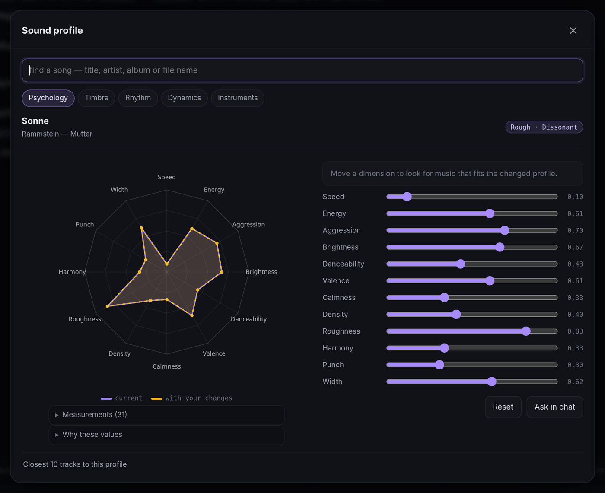
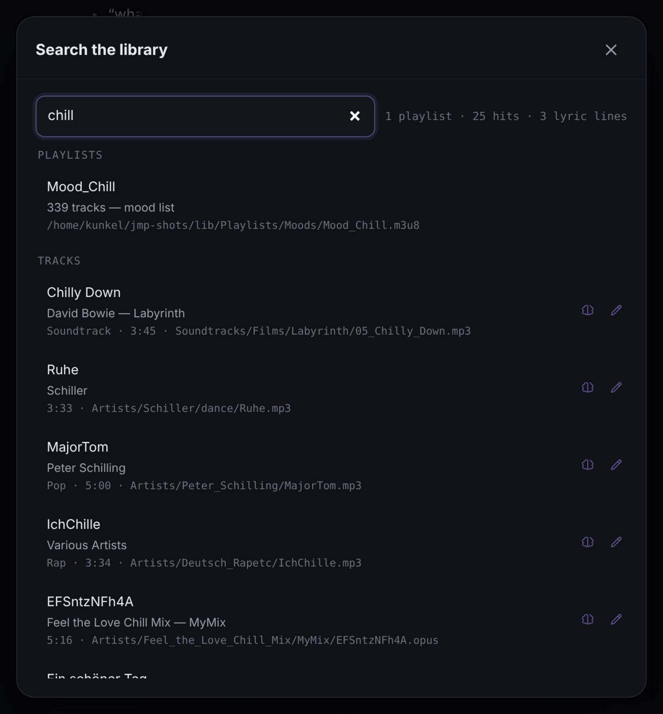

# JulAIn Music Player (JMP) — build, install, run


**Chat with your music, keep it local.** JMP is an **AI-driven music player**:
it indexes a music folder you already own, plays it through mpv, and lets you
search, queue, build playlists, rank and reshape tracks by **measured
psychoacoustics**, read timed lyrics and teach it what you like — by typing or
speaking a sentence in English or German, in a window that runs on this
machine. No account, no telemetry, no cloud unless you choose a remote
planner.

- **AI and LLM:** an offline intent parser by default; an optional
  OpenAI-compatible LLM planner, fenced to read-only library tools plus a few
  journalled writes; local Whisper for lyrics and voice.
- **Psychoacoustics:** 35 measurements per song → 12 axes, 5 profile sets,
  8 sound families, “find something 20 % faster” search, and a reason for
  every rank.
- **Natural language:** moods, lengths, rankings, lyrics, library questions,
  imports and every setting — see [what you can type](#3--what-you-can-type).
- **Architecture and data privacy:** [`docs/architecture.html`](docs/architecture.html)
- **Licence audit (and the open-release answer):** [`docs/licences.md`](docs/licences.md)
- **Licence:** GPL-3.0-or-later, see [`LICENSE`](LICENSE)
- **How it was built:** written in pair programming with an AI coding agent,
  see [`NOTICE`](NOTICE)

`application/` is the complete deliverable: the app's code, its container
definition and the installers.  Copy the folder (the repository around it
holds the music library) and everything needed is in here.


```
application/
├── install-desktop.sh          one-stop installer: image + compose + launcher (docker)
├── install.sh                  the installer itself (--docker / --host)
├── build-image.sh              docker/podman build only
├── build-deb.sh                Debian/Ubuntu package (dist/*.deb)
├── publish-release.sh          tag + GitHub release + asset upload
├── packaging/deb/              launcher, man page, copyright, maintainer scripts
├── docs/screenshots/           the real captures used above
├── VERSION                     release version of the package
├── Dockerfile                  the image (build context = this folder)
├── compose.yaml                manual compose project for this checkout
├── entrypoint.sh               installed in the image as `music`
├── requirements.txt            runtime deps (mutagen, numpy, textual)
├── julians-music-app.desktop   GNOME / freedesktop launcher (opens the chat window)
├── julians-music-app.svg       launcher icon (scalable)
├── lib/                        the app itself
│   ├── music.py                the CLI (and `music chat`)
│   ├── mpvctl.py               mpv JSON-IPC client
│   ├── playlist_edit.py        journalled playlist editor
│   ├── add_file.py             local files → tag → file
│   ├── libpaths.py             finds the library (MUSIC_LIBRARY wins)
│   ├── chat/                   the conversational front end
│   │   ├── app.py              the Textual TUI
│   │   ├── plain.py            the line-based fallback
│   │   ├── web.py              the window server (token API + page)
│   │   ├── window.py           optional native GTK/WebKit window
│   │   ├── webui/              index.html, app.css, app.js (the window)
│   │   ├── engine.py           turns a plan into a skill call
│   │   ├── nlu.py              offline bilingual intent parser
│   │   ├── llm.py              optional OpenAI-compatible planner
│   │   ├── tools.py            the fenced tools the planner may call
│   │   ├── downloads.py        facade for optional download modules
│   │   ├── selection.py        mood/feature playlist builder
│   │   ├── catalog.py          inventory, search, playlists
│   │   ├── profile.py          what the app learned about you
│   │   ├── player.py           playback with friendly errors
│   │   ├── psycho.py           reads the profile database (net diagram)
│   │   ├── psycho_job.py       starts/polls the background measurement job
│   │   ├── index_job.py        starts/polls the background index job
│   │   ├── lyrics.py           reads the lyrics database (timed lines, search)
│   │   ├── lyrics_job.py       starts/polls the local transcription job
│   │   └── skills.py           the skill registry/loader
│   ├── asr/                    bundled local Whisper transcriber + setup
│   └── skills/                 one SKILL.md per skill
└── README.md
```

The app never deletes audio and never moves a file without a journal entry;
the rules in `AGENTS.md` apply unchanged.  The library is only ever *mounted*,
never copied.

## An AI-driven player: LLM, psychoacoustics, natural language

JMP is not a playlist manager with a chat box glued on.  Three things are the
product, not decoration:

1. **A language layer turns sentences into journalled actions** — an offline
   English/German parser by default, an optional LLM when you configure one.
2. **It listens to the audio itself** — 35 psychoacoustic measurements per
   song, rolled up into twelve interpretable axes, five profile sets and eight
   sound families.
3. **It answers in natural language and understands it** — moods, lengths,
   rankings, lyrics, library questions, imports and every setting.

### 1 · AI and LLM driven

| layer | what it does | runs where |
|---|---|---|
| **Offline planner** (`chat/nlu.py`) | The default. A deterministic, bilingual intent parser turns a sentence into one skill call: playback, playlist, ranking, lyrics, search, import, settings. No model, no network, no API key. | in-process |
| **Optional LLM planner** (`chat/llm.py`) | An OpenAI-compatible agent loop with a **fenced tool list**. It may read the catalogue, the profile database and playlists; with an optional download module installed it may also use that module's search and queue.  It may write a custom playlist. It cannot run a shell, take a filesystem path, delete audio or retag a file. Point it at a local **Ollama** or a remote server (GWDG/SAIA, or any base URL). | your choice: local or remote |
| **Local speech-to-text** | Lyrics for the whole library and microphone input — Whisper runs on this machine (`faster-whisper`), with timed lines and an FTS index. | local ASR venv |
| **Learned phrasing** | "when I say sunday I mean chill and jazz" becomes a stored phrase; likes, dislikes, notes and skip behaviour bias later picks. | app state |
| **Explanations** | Every ranking can be taken apart: "why is this the most aggressive?" reconstructs the axis from the measured columns. | local SQLite |

With `use_llm` off — the shipped default — the app is fully deterministic and
fully offline.  The LLM is an **optional understanding layer**, never the thing
that touches your files.  `music-cli chat --no-llm` forces the offline planner
even when a model is configured.

### 2 · Psychoacoustics

`scripts/psycho_features.py` decodes the middle 40 s of each track and measures
35 values — tempo, onset rate, pulse clarity, beat stability, LUFS, crest
factor, spectral centroid/rolloff/flatness, sharpness, harmonicity, roughness
(Sethares/Plomp-Levelt), key clarity, major/minor, stereo width, five band
shares, attack sharpness and more.  `scripts/psycho_profile.py` turns them
into **percentile ranks over your library**, so 0.5 is average *here*:

| lens | axes |
|---|---|
| **Psychology** (default) | speed, energy, aggression, brightness, danceability, valence, calmness, density, roughness, harmony, punch, width |
| **Timbre** | warmth, brightness, presence, air, sharpness, harmonicity, noisiness, roughness |
| **Rhythm** | speed, beat clarity, regularity, onset density, complexity, drive |
| **Dynamics** | loudness, loudness range, micro-dynamics, punch, silence, trend |
| **Instruments** (estimated) | bass, drums, strings, keys, voice, classical |

What that buys you in the window: a **net diagram** per song, a *Profile*
button, comparisons ("find music similar to this but faster", "find
something 20 % faster"), rankings ("the 10 most aggressive tracks"), an explanation for
each rank, generated **sound-family playlists**, and optional loudness
levelling toward −16 LUFS without touching a single audio file.  Mood and focus
lists are built from the same measurements.

Honest limits: the axes are relative to *this* library, tempo floors at 60 BPM,
the instrument set is a band-share heuristic rather than a trained classifier,
and a broken rip stays a silent row instead of being invented.

### 3 · What you can type

Everything below works in the window composer, the TUI, and
`music-cli chat "…"`.  English and German are both understood; a few German
forms are shown where they differ in structure.

| you want | say |
|---|---|
| **Play / transport** | "play Bands", "play die ärzte", "play the whole library shuffled", "play something chill", "pause", "next", "volume 40", "jump to 2:30", "continue where I left off", "endless mode", "shuffle mode on" |
| **Playlists and queues** | "create a smooth playlist for work", "a two-hour party playlist", "one hour of metal", "zwei Stunden Entspannung", "a playlist with 30 tracks of rock", "add some jazz to my evening", "save that as Late Night", "remove 2 from Mix", "make a smart playlist of 90s metal", "make a smart playlist of tracks longer than 8 minutes, shuffled" |
| **Sound, mood and rank** | "find the slowest and boring song", "the 10 most aggressive tracks", "why is this the most aggressive?", "find music similar to this but faster", "find something 20 % faster", "show the timbre profile", "find the most bass-heavy song", "show the psycho families", "is the radio on?", "start a radio from this song", "more radio", "keep the music going", "never stop the music" |
| **Lyrics** | "show the lyrics", "songs about the sea", "which song mentions pizza", "how many songs mention pizza", "export the lyrics as lrc", "shift the lyrics half a second later", "the lyrics are too early", "how many songs have lyrics" |
| **Your library as data** | "how many tracks do I have", "which genres do I have most of", "what formats do I have", "the longest track", "what did I add this month", "what's new", "how complete is the library", "is the library healthy", "show duplicate 3", "library statistics" |
| **Import** *(optional module)* | "search the import source for <words>", "download 2", "download all", "retry the download", "clear the failed download", "add <url> to my library" — these need a build with an import module; without one the chat says so |
| **Playlist import** | "import all playlists from ~/Downloads/playlists", "import this spotify playlist <link>" |
| **Settings and upkeep** | "show the settings", "turn off the visualizer", "turn off the daily backup", "keep the last 5 backups", "use gwdg with api key sk-…", "change the music folder to /home/me/Musik", "index the library", "pause the indexing", "measure the library", "transcribe all songs without lyrics" |
| **Feedback and learning** | "I like this", "I don't like this", "das gefällt mir", "when I say sunday I mean chill and jazz", "that worked, remember it" |

Two rules the chat keeps: a **lookup lists, only a play word plays**, and it
**never deletes a song**.  Playlist edits and deletes are journalled; audio
only enters through a local add or, when a build includes an optional
download module, through that module — which checks duplicates and
decodability first.

## What it looks like

Two things the window does, captured from a running library of ~17,500
tracks.  Nothing is mocked up: the numbers, lyrics and results come from the
library the window was pointed at.

**A sound profile, not a genre tag.**  Every track is measured, ranked against
the rest of the library and drawn as a net diagram.  Move a slider and the
nearest tracks are recomputed; the measurements behind each axis are one click
away under *Why these values*.



**One search over tracks, playlists and sung lines.**  A single query returns
matching playlists, matching tracks from the tags and the inventory, and the
lines a song actually sings — so “chill” finds `Mood_Chill`, the tracks tagged
that way, and the songs whose words say so.



## Install on this computer

```bash
application/install-desktop.sh
```

That single command installs everything and leaves the window open.  It

1. **installs the system pieces** it can get from the distribution's package
   manager — without root it prints the exact command and continues,
2. **builds the image** `julians-music-app:latest` from this folder,
3. **writes a compose project** at
   `~/.local/share/julians-music-app/compose.yaml` that mounts your music
   folder at `/library`, runs as your uid/gid and passes the host sound device
   through,
4. **installs the launcher**: `~/.local/bin/music-cli`, the `.desktop` entry
   and the icon,
5. **starts the container** and **opens the chat window** when a display is
   available (`--no-launch` installs without starting anything).

What it tries to install, per distribution:

| piece | why | Debian/Ubuntu | Fedora | Arch | openSUSE | Alpine |
|---|---|---|---|---|---|---|
| PyGObject + WebKitGTK | native window instead of a browser tab | `python3-gi gir1.2-webkit2-4.1` | `python3-gobject webkit2gtk4.1` | `python-gobject webkit2gtk-4.1` | `python3-gobject typelib-1_0-WebKit2-4_1` | `py3-gobject3 webkit2gtk-4.1` |
| `mpv` | playback | `mpv` | `mpv` | `mpv` | `mpv` | `mpv` |
| `docker` | the container build | `docker.io` | `docker` | `docker` | `docker` | `docker` |
| `ffmpeg` | probing, mood analysis | `ffmpeg` | `ffmpeg` | `ffmpeg` | `ffmpeg` | `ffmpeg` |

Each piece is only installed when it is actually missing, and a missing piece
never aborts the install: without the GTK/WebKit bindings the window opens as a
Chromium `--app` window, without `mpv` the app says so instead of pretending.

Docker (or podman) is required for the container build.  When no runtime can be
made to work — missing, daemon down, socket not writable — the installer falls
back to the host build and says why; `--no-fallback` restores the hard error.

The music folder is chosen in this order:

| order | source |
|---|---|
| 1 | `--library DIR` |
| 2 | `$MUSIC_LIBRARY` |
| 3 | `~/Musik` when it exists |
| 4 | the repository around `application/` |

```bash
application/install-desktop.sh --library ~/Musik
application/install-desktop.sh --dry-run          # print everything first
application/install-desktop.sh --no-build         # reuse an existing image
application/install-desktop.sh --prefix /usr/local  # system-wide (sudo)
application/install-desktop.sh --no-launch        # install, start nothing
application/install-desktop.sh --no-fallback      # fail when docker is absent
application/install-desktop.sh --uninstall
```

The container is started by the install (and by the first `music-cli` call if
it is ever down); it stays up between commands, because the headless mpv daemon
lives in it:

```bash
docker compose -f ~/.local/share/julians-music-app/compose.yaml down   # stop it
```

### No docker? Use the host build

`install-desktop.sh` falls back to this by itself when no container runtime
works.  It can also be installed directly:

```bash
application/install.sh --host                 # own venv + launcher
application/install.sh --host --no-venv --python "$(command -v python3)"
```

Everything works the same, except that playback and `ffmpeg` must be installed
on the host (`sudo apt install mpv ffmpeg`) and the app is not isolated in a
container.  The venv gets the same `requirements.txt` as the image.  Audio
download is not part of it: a build with `--modules DIR` compiles an optional
download module and installs that module's own requirements.

### Ubuntu / Debian package (.deb)

The release page carries a package built for Ubuntu 24.04 and 26.04
(“resolute”, Python 3.14):

<https://github.com/JulianKunkel/jmp-ai-music-player/releases>

```bash
wget https://github.com/JulianKunkel/jmp-ai-music-player/releases/latest/download/jmp-ai-music-player_1.1.3-1_all.deb
sudo apt install ./jmp-ai-music-player_1.1.3-1_all.deb
```

It installs the app under `/usr/lib/jmp`, the launcher `/usr/bin/music-cli`,
the desktop entry, the icon and the manual page (`man music-cli`), and runs on
the distribution's Python 3 — no virtualenv, no pip.  Dependencies come from
Ubuntu: `python3-mutagen`, `python3-numpy`, `mpv` and `ffmpeg` are required;
`python3-gi` + WebKitGTK (native window) and `python3-textual` (terminal UI)
are recommended.  The package contains **no download feature**; only builds
with an optional module have one.

Point it at your library once — a folder with `Playlists/` and either
`Artists/` or `library-work/`:

```bash
echo "$HOME/Musik" > ~/.config/jmp/library     # or export MUSIC_LIBRARY=…
music-cli chat --web
```

The player finds `~/Musik`, `~/Music`, `~/music` and the current folder by
itself; `~/.config/jmp/library` (or `/etc/jmp/library`) overrides that.
Indexing, psychoacoustic measurement, tagging and the sound features call the
library's own toolkit in `<library>/scripts/` and use its `library-work/`; the
package ships the player, not those per-library tools.  Lyrics are the
exception: the local Whisper transcriber is bundled and installs its backend
into the library (see [Lyrics](#lyrics-local-transcription)).

Build the package from this folder — the script is reproducible, needs only
`dpkg-deb`, and produces `dist/jmp-ai-music-player_<version>_all.deb` plus a
SHA-256 file:

```bash
./build-deb.sh                          # version from VERSION
./build-deb.sh --version 1.0.1 --out /tmp/release
./build-deb.sh --modules ../download-modules   # optional: compile a module in
```

Publishing is one command as well.  It builds (or reuses) the package, checks
and pushes the tag, creates the release if needed and uploads the `.deb` and
its `.sha256`; GitHub's release API needs a token, so on the first run it asks
you to log in with `gh` (git stays on SSH):

```bash
./publish-release.sh                     # tag v$(cat VERSION), upload
./publish-release.sh --draft --notes release-notes.md
```

## What you get

`music-cli` (the launcher opens the chat window with it):

```bash
music-cli play Bands                  # playlist, file, URL or search hit
music-cli play "die ärzte"
music-cli play --shuffle --append All
music-cli pause | resume | next | prev | stop | status
music-cli seek +30 | vol 65
music-cli search "chill piano"
music-cli chat "create a smooth playlist for work"
music-cli pl list | show Mix | add Mix --track PATH | remove Mix --index 2
music-cli import <link>                # needs an optional import module
music-cli add ~/Downloads/song.flac    # tag + file + index
music-cli mood list | mood play chill | mood build
music-cli index                       # rescan + rebuild the generated lists
music-cli verify
music-cli shell                       # a shell in the library
```

With the container install every one of those commands is executed inside the
container, so the host only needs docker — no Python packages, no ffmpeg, no
mpv.

The launcher opens the **chat window**.  Right-click it for the two shortcuts
*Play the whole library (shuffle)* and *Play the chill list*.

## The chat

`music-cli chat --web` is what the launcher runs: a real application window, not
a terminal.  The behaviour is a conversation with the library, and every side
effect still goes through the journalled tools:

```bash
music-cli chat --web                    # the window (the launcher's command)
music-cli chat --web --no-open          # start the server, print the URL
music-cli chat --web --port 8765        # a fixed port
music-cli chat --web --idle-exit 1800   # stop after 30 min without a request
music-cli chat                          # the Textual TUI in this terminal
music-cli chat --plain                  # line-based, for a bare console
music-cli chat "play Bands"             # one turn, print, exit
music-cli chat --no-llm                 # offline planner only
music-cli chat --dry-run                # plan playlists, write nothing
```

Typical requests, English or German:

```
create a smooth playlist for work
make me a two-hour party playlist
play the whole library shuffled
find everything by Die Ärzte
play number 2                  (a hit from the last answer)
add <url> to my library          (needs a download module)
import all playlists from ~/Downloads/playlists
import this spotify playlist https://open.spotify.com/playlist/…
I like this but not that
when I say sunday I mean chill and jazz
how big is my library?
find the slowest and boring song
show the 5 most aggressive tracks
show the settings
use gwdg with api key sk-…
change the music folder to /home/me/Musik
```

The composer has a **microphone**: hold a sentence, it is transcribed on this
machine and answers like typing (see *Voice input*).  Every setting in the
window is also reachable from the chat — see *Settings* under the window UI.

### The window UI

`chat/web.py` serves a single-page app from `chat/webui/` on a free loopback
port with a random token, then shows it in its own window:

| order | opener | when |
|---|---|---|
| 1 | `chat/window.py` (GTK + WebKit) | a native window: PyGObject plus WebKitGTK on the host |
| 2 | `chromium/chrome/brave/edge/vivaldi --app=…` | no GTK/WebKit, but a Chromium-like browser |
| 3 | `open -na` (macOS), `webbrowser.open` | anything else |
| 4 | `notify-send` / `zenity` notice | nothing at all, prints the URL |

The native window is what makes the app sit in the GNOME dash like any other
program: the window class is `julians-music-app` — `Gdk.set_program_class()`
on GTK3, the app id from `GLib.set_prgname()` on GTK4/Wayland — which is the
desktop file's own id and its `StartupWMClass`. The Chromium fallback passes
`--class=julians-music-app` for the same reason. It needs no Python package in
the app venv — `window.py` is standalone and runs on the host's `python3`:

```bash
sudo apt install python3-gi gir1.2-webkit2-4.1     # Debian/Ubuntu, GTK3 + WebKit2
# or, for GTK4 + WebKitGTK 6.0:  python3-gi gir1.2-webkit-6.0
python3 application/lib/chat/window.py --check      # prints gtk4 / gtk3, exit 3 if absent
```

The page itself is vanilla HTML/CSS/JS served by the standard library, so there
is no new Python dependency.

- **Left column:** now playing with cover, transport, seek bar, volume and the
  *More like this / Less* feedback; one compact stats line; then the grouped
  playlist list (shelves, moods, focus, sound families, yours) — clicking one
  plays it.
- **Visualizer** next to the cover, with three small buttons in the strip's
  header: the brain icon opens the **sound properties** of the track that is
  playing (same panel as the *Profile* button, the cover does it too), the
  sliders icon cycles the drawing style, the wave icon turns the strip off.
  Seven styles: *bars*, *equalizer*, *LED columns*, *oscilloscope*, *VU
  meters*, **live spectrum** and **sound properties**.
  - The first five draw the cached 180-bucket peak envelope of the current
    track, so switching costs no decoding.
  - **Live spectrum** is a real FFT: `scripts`-free, the server decodes the
    track once at 22.05 kHz and stores 24 log-spaced bands (60 Hz … 8 kHz)
    every 0.25 s in `library-work/app/chat/spectra/`.  The strip shows the
    bands of the **last second** before the playhead, with octave marks
    (100 Hz / 1 kHz) and a decaying peak-hold line per band.  It is the
    measured spectrum of the track, not a decoration.
  - **Sound properties** draws the twelve profile axes of the playing track as
    labelled bars (Speed … Width), read from
    `library-work/app/psycho/features.db`.

  The style is remembered in `profile.json` (`/viz spectrum`, `/viz axes` from
  the chat) and the list itself comes from the server (`viz.STYLES`), so page
  and backend cannot drift apart.
- **Transcript:** the same `Engine.handle` answers as the TUI, rendered from
  safe server-side Markdown.  A track list under an answer expands into
  clickable rows; a path line in the text is clickable too.
- **Composer:** Enter sends, Shift+Enter adds a line; quick chips come from
  `skills.examples()`.  The **microphone button** records a sentence
  (`Ctrl+Shift+V`), transcribes it locally and sends the words — see *Voice
  input* below.
- **Downloads** are optional.  The open player never downloads audio; a build
  that compiles an import module (see [`docs/modules.md`](docs/modules.md))
  adds an **Import** button and the matching chat sentences ("search the
  import source for …", "download 2", "download all").  Without a module the button is hidden,
  the tool list has no download tools, and the chat answers that this build has
  none.  Everything else in this page works either way.
- **Search** (`Ctrl+F`) opens one box that matches any part of the title,
  artist, album, genre, shelf or path — **and the playlists**.  Every hit is a
  button: a **track** loads that file into the player, a **playlist** (a shelf
  list, a mood or focus list, one of your own, a sound family) loads the whole
  list, exactly like clicking it in the sidebar or saying "play Bands".  The
  list is grouped into *Playlists* and *Tracks*, each with its size and kind,
  and a track has a second button that opens its sound profile.
- **Media keys** work like the transport buttons: play/pause, next, previous
  and stop.  A keyboard whose media row sits behind F5–F8 works as long as the
  row is in function mode, and the four keys mean what they are printed to
  mean (on this machine's row: `F5` stop, `F6` rewind, `F7` play/pause, `F8`
  forward — a different keyboard is corrected with
  `~/.config/julians-music-app/media-keys.json`, no rebuild; `Ctrl+F5` stays a
  shortcut).  Those plain function keys reach only the focused window; to have
  them work in every application, switch the row to multimedia mode, where
  the keys are real `XF86Audio*` and the desktop routes them through MPRIS.
  The
  native GTK window publishes an **MPRIS** player
  (`org.mpris.MediaPlayer2.jmp`), so the desktop's own media keys reach the
  player even while the window is in the background; a small host agent keeps
  that MPRIS player alive after the window is closed, so the keys still work
  while the music runs in the container.  In a browser window or on a phone
  the page handles them while it has focus.  Every key becomes the same
  `POST /api/transport` call as the matching button; no file is touched.  A key
  that meets a stopped player starts what was playing last (play, back,
  forward), and back restarts the current track when it is already under way,
  so no key ever leaves the room silent.  If a
  key does nothing, `~/.cache/julians-music-app/media-keys.log` records every
  media/function key the window, the page and a global shortcut saw (never
  ordinary typing), including which route a shortcut reached.  A
  function-key row is focus-only by design (Wayland has no global key
  observation); `jmp-media-keys --install` registers the same four keys as
  GNOME global shortcuts, so they work in every application — at the cost of
  taking `F5`–`F8` from other applications (`jmp-media-keys --remove` gives
  them back).  The shortcut runs `jmp-media-action`, which reaches the running
  player through its loopback API first, then the MPRIS player, and only then
  falls back to `music-cli` — so a source install, a `.deb` and a player in a
  container cannot point the key at the wrong socket.  The same install is in
  the window: **Settings → Playback → Global media keys** shows each key as
  *global* or *window only*, names a key that another GNOME shortcut already
  owns, and installs, removes or **tests** the route a press would take in one
  click (the native window performs the desktop calls, since the server runs
  in a container without a session bus).  One toast at start says the keys are
  focus-only, and the first real key press offers the setup once with the
  tradeoff in plain words; nothing is installed silently.  **Test** also says
  when the running window is older than the page (restart the app), and logs a
  bound key that still reached the window as *not grabbed* — the desktop then
  never took the key over.
- **Profile** opens the sound net diagram of the current song: the twelve
  measured axes as a radar polygon, a slider per axis, the grouped
  measurements (rhythm, loudness, timbre, tonality, bands and space) in a
  collapsible panel, and the tracks that fit the changed profile below it
  (click one to play it).  The values come from
  `library-work/app/psycho/features.db`; see *Sound profile* below.
- **Transport** is not just play/pause: `stop`, `next`, `prev`, `seek ±30`,
  `seek to 1:30`, `restart`, `volume 65`, `louder`/`quieter` (relative),
  `mute`/`unmute`, `speed 1.5x` / `half speed`, `shuffle on|off`,
  `repeat one|all|off`, and "play entry 3 in the queue".
- **Settings** (gear icon) holds **every** setting — there is nothing you have
  to edit by hand.  The panel is built from one registry
  (`lib/chat/settings.py`), and `GET /api/settings` returns the same rows, so
  the page, the chat and the planner's tools can never disagree about what
  exists.
  - **Library → Music folder** — the path the app works on.  The container
    mounts exactly one folder at `/library`, so everything below it is
    readable and nothing outside it is.  *Use this folder now* switches live
    when the process can see the folder; one it cannot (the usual case in the
    container, where the host path does not exist) is written to
    `library-work/app/chat/settings.json` and used by the next start, because
    the launcher reads that file and mounts what it names.  An explicit
    `--library` still wins.
  - **Chat** — the planner switch (`use_llm`), how many tracks a request aims
    for (`default_count`).
  - **Playback** — auto-play, visualizer on/off and its style.
  - **Sound profile** — the profile lens (`psycho_set`), measuring on start,
    and the two buttons: how many tracks are measured, how many still carry
    the older estimates, how many profiles and families exist.  *Measure the
    library* fills in only what is missing, *Re-measure everything* ignores
    the cache; both run `scripts/psycho_features.py --apply` and then
    `scripts/psycho_profile.py --apply` as **one detached background job**, so
    the window keeps working and the progress bar moves while it measures.  A
    job keeps running when the window closes, survives a server restart, and a
    second click joins the running one instead of starting another.
    *Measure automatically on start* (`psycho_auto`) is the normal path: the
    numbers are refreshed by the app, not by hand.
  - **Lyrics** and **Voice** — panel on/off, microphone on/off, send at once
    or put the words in the box, spoken language and model, plus a line that
    says whether a local transcriber is really usable on this machine.
  - **Language model** — the planner server: *automatic*, a **local Ollama**,
    **GWDG / SAIA (AcademicCloud)**, or **any other OpenAI-compatible address**
    with a base URL and a model.  The API key is typed here and stored in
    `library-work/app/chat/secrets.json` (mode 0600); it is never echoed back,
    never appears in `/api/state`, and an empty field means "keep the stored
    key".  *Reload the model list* asks the server what it offers
    (`/v1/models`, or Ollama's `/api/tags`) and offers the names in the model
    field.  Choosing Ollama or GWDG also turns the planner on and clears a
    stale address, so an old local URL cannot win over the new choice.
  - **Diagnostics** — the server counters, the last error and this window's
    failed calls, with *Copy report*.
  - A value the app does not understand is **refused** with the allowed
    choices and the old value stays; a stored value that has since become
    invalid silently falls back to its default on read.
  - The same settings are reachable from the chat — "show the settings",
    "voice settings", "set the default count to 60", "use gwdg with api key
    sk-…", "change the music folder to /home/me/Musik", "reset the
    visualizer".  A music file is never touched by any of it.
- **Skills** opens a dialog with one actionable example per skill, so the
  window teaches itself.
- `quit` stops the local server after a confirmation; playlists, tags and
  everything learned are already saved.

A second launch reuses the running server: it reads
`library-work/app/chat/server.json`, finds the live URL and just reopens the
window.

In the **container install** the window still belongs to the host.  The compose
project publishes `127.0.0.1:8765` only, the wrapper starts
`music chat --web --no-open --host 0.0.0.0 --port 8765` inside the container,
reads the URL from the mounted `server.json`, rewrites `0.0.0.0` to
`127.0.0.1` and opens the host window — native GTK/WebKit through the installed
`lib/chat/window.py`, otherwise a Chromium app window, otherwise the default
browser.  So `music-cli chat --web` behaves
the same with or without docker, and the page never leaves the loopback
interface.

The TUI and `--plain` are unchanged.  TUI keys: `F1` help · `F2` skill drawer ·
`F3` now playing · `Ctrl+L` clear · `Ctrl+P` prompt · `Ctrl+Q` quit.
`/skills` lists everything, `/llm` shows the planner, `/quit` leaves.

How it works:

- **Skills** are OpenCode-style folders under `lib/skills/<name>/SKILL.md`.
  Nineteen exist: search-library, play-music, transport, make-playlist,
  recommend, show-playlists, save-playlist, edit-playlist, activity,
  psycho-profile, index-library, lyrics, rank-library, import-audio (an
  optional-module notice when no module is installed), import-playlist,
  add-file, learn-preferences, agent, library-overview.
- **Planning is offline by default.**  `chat/nlu.py` handles every skill in
  English and German, including "find the slowest and boring song" — that is a
  real ranking over the measured profile database (`rank-library`), not a text
  search, because words like *slow* or *boring* appear in no tag.  An optional
  model is used as an **agent**: when the wording stays unclear it may call a
  fixed set of tools (see below), look the library up and then answer, instead
  of only naming one skill.
- **The model's tools are fenced** (`chat/tools.py`).  Read tools query the
  catalogue, filter by metadata, rank measured tracks, show a song's axes,
  find similar ones and list and show playlists.  The only writes are
  playlists (create, add, remove, rename, delete a **custom** list) and, when a
  build has a download module, that module's import queue.  There is no tool
  that deletes, moves or retags a music file, and no tool accepts a filesystem
  path: a track is always a library-relative path the catalogue already knows.  Two request
  guards keep even the allowed writes honest — a playlist is deleted only when
  the listener's own sentence says so, and a download only when it asks to
  download/import.  A provider that does not understand tool calling is
  detected once and the planner degrades to the JSON skill form.
- **Playlists** are built from the measured mood features (`library-work/moods/
  features.jsonl`) plus genre/shelf priors, standardised against the whole
  library, so "smooth for work" blends Chill + Focus instead of taking a raw
  score.  They are saved as `Playlists/Custom/<Name>.m3u8` with relative paths,
  so VLC and mpv can use them outside the app, and the write is journalled to
  `library-work/journal/playlists.jsonl` first.  Generated shelf lists are
  never edited.
- **Learning** lives in `library-work/app/chat/profile.json` (never in a music
  file): explicit likes/dislikes, notes, learned phrases, recent plays, and
  weak implicit signals (a track heard past 65 % counts as a small like, one
  skipped in the first 15 % as a small dislike).  Weights pass through `tanh`
  when selecting, so one enthusiasm cannot drown out the audio features.
- The chat **never deletes a song**.  It can create, edit, rename and delete a
  **custom playlist** (the content goes into the journal first, so
  `playlist_edit.py --rollback` restores it); the generated shelf, mood, focus
  and psycho lists are refused.  Removing entries only edits a custom list.
- Sessions are appended to `library-work/app/chat/sessions/`.

### When the window says “Load failed”

That text comes from WebKit's `fetch`: it means the answer never arrived at
all, not that the request failed on the server.  The server now guarantees an
answer — every route is wrapped, so an exception becomes a JSON 500 with
`error`, `kind`, `where` (the endpoint) and `log` (the file to read) instead of
a dropped connection, and an unread POST body is closed with
`Connection: close` so the socket cannot hang.

Everything is counted in `Diagnostics` (in memory) and written to
`library-work/app/chat/`:

| file | content |
|---|---|
| `server-requests.log` | one line per request: time, method, clean path, status, milliseconds (rotated at 1 MB) |
| `server-errors.log` | every 500 with the exception type and traceback |
| `server.json` | the live pid, url and root of the running server |

`GET /api/diagnostics` (token-protected like everything else) returns the
counters: requests, by status, slowest routes, last errors, `client_errors`.
The page shows the same in Settings → **Diagnostics**, and a single banner
appears when an endpoint stops answering; it disappears as soon as
`/api/ping` succeeds again.

The browser side is defensive too: each endpoint has its own `AbortController`
timeout (`/api/chat` 240 s because the planner may wait on the model,
`/api/spectrum` 120 s for the first FFT, waveform 90 s, …), a GET is retried
once, and the message names the endpoint.  Set `MUSIC_WEB_DEBUG=1` to log
every request in the server's own output as well.

If the text still appears, read the two logs first: a 500 names the endpoint
and the exception, a missing line means the request never reached the server
(the window lost the port — check `server.json` and restart the app).

### Sound profile (psychoacoustics)

Two library scripts, both read-only towards the music:

```bash
scripts/venv/bin/python scripts/psycho_features.py --seed     # import the mood cache
scripts/venv/bin/python scripts/psycho_features.py --apply    # measure the real columns
scripts/venv/bin/python scripts/psycho_profile.py --apply     # axes, families, playlists
scripts/venv/bin/python scripts/psycho_profile.py --rollback  # remove the generated lists
```

`psycho_features.py` decodes the middle 40 s of every file (stereo
22.05 kHz) through ffmpeg and measures 35 values, grouped the way the panel
shows them:

| group | measurements |
|---|---|
| Rhythm | tempo (BPM), onsets/s, pulse clarity, beat stability, rhythmic complexity |
| Loudness | LUFS (BS.1770 K-weighted, dual-mono counted once), level dBFS, micro-dynamics, loudness range LU, crest factor, level trend, silence share |
| Timbre | centroid, rolloff, spread, skewness, kurtosis, flatness, spectral entropy, sharpness (acum), harmonicity, zero crossings, percussiveness, spectral flux |
| Tonality | key clarity, major/minor, sensory dissonance (Sethares/Plomp-Levelt), repetition |
| Bands and space | sub (<60 Hz), low (<200 Hz), mid (200–2000 Hz), presence (2–5 kHz), high (>4 kHz), stereo width (side/mid), attack sharpness |

The result is one row per file in the SQLite database
`library-work/app/psycho/features.db` (tables `audio`, `profile`, `profile_set`,
`family`, `meta`).  `--seed` imports the 12k rows the older mood analyser
already measured, so the app is usable at once; the columns it never had stay
NULL until `--apply` fills them in.  `--refresh` re-measures every row, `--stats`
prints the distribution and the `detailed`/`newest` feature counts.  A silent
middle window (a broken rip) yields a silent row and therefore a flat profile —
the panel then shows what was really measured instead of inventing values.

The middle 40 s window is measured in stereo at 22.05 kHz; the 35 columns are
the seventeen the first version had plus fourteen added in 2026-11 — the band
shares `sub_ratio` (<60 Hz), `mid_ratio` (200–2000 Hz) and `presence_ratio`
(2–5 kHz) among them — plus `attack_sharpness` (the median relative onset
rise).  A row measured before
those columns existed is picked up again by the next `--apply`, without
`--refresh`.

`psycho_profile.py` derives twelve 0..1 axes as percentile ranks over the
library (speed, energy, aggression, brightness, danceability, valence,
calmness, density, roughness, harmony, **punch**, **width** — documented with
their weights in `library-work/reports/psycho-profiles.md`), groups the library
into k-means families, names each family by the axes where it differs from the
others, and writes one playlist per family to `Playlists/Psycho/` (kind
`psycho`, so it is listed under *Sound families*).  The app reads the database
read-only through `lib/chat/psycho.py`; nothing in the chat writes it.

The same measurements are also written to `profile_set` through four more
lenses, so the net diagram can switch sets without a second measurement:

| set | axes |
|---|---|
| **Psychology** (default) | speed, energy, aggression, brightness, danceability, valence, calmness, density, roughness, harmony, punch, width |
| **Timbre** | warmth, brightness, presence, air, sharpness, harmonicity, noisiness, roughness |
| **Rhythm** | speed, beat clarity, regularity, onset density, complexity, drive |
| **Dynamics** | loudness, loudness range, micro-dynamics, punch, silence, trend |
| **Instruments** (estimated) | bass, drums, strings, keys, voice, classical |

Every set is again a percentile rank over this library, built from the same
columns, so 0.5 is average inside each set.  The instrument set is explicitly a
heuristic over band shares and transients — *not* a trained instrument
classifier — and says so in the UI and the report.  Families, the chat default
and the generated playlists stay on the psychology set; a set row is flagged
`estimated` when a column it rests on was never measured.  Distribution per
set: `library-work/reports/psycho-sets.csv`.  The app remembers the chosen set
in `library-work/app/chat/profile.json` (`psycho_set`) and `/api/psycho?set=…`,
`/api/psycho/similar {set}` take it per request; `/api/state.psycho.sets` lists
the five sets with their track counts.

The app measures the library itself: Settings → **Sound profiles** →
*Measure the library*, or "measure the library" / "update the sound profiles"
in the chat, or nothing at all — with `psycho_auto` on (the default) a start
fills in whatever is missing.  The job is written to
`library-work/app/psycho/jobs/<id>.json` (record), `<id>.log` (the child's
output), `<id>.rc` (its exit code), so progress survives a closed window and a
restarted server; one job runs at a time.

In the app: "what are the properties of this song", "show the psycho
families", "find music similar to <track> but faster" / "find something
20 % faster", "show the timbre profile", "which profile sets are there".  The
**Profile** button and the **Properties** button on the visualizer open the net
diagram; a strip of chips above it switches between the five sets, and moving
a slider searches the library for the nearest profile and lists it, weighted so
the axes you moved count 1.6× — otherwise the untouched axes would average a
change away.  An instrument property ("find the most bass-heavy song") is a
ranking inside the instrument set, so it is an estimate by construction.

### Library index (the inventory, the reports, the playlists)

"Index the library", "rescan the library", "rebuild the library index",
"how is the indexing going" (German: "indizieren", "neu einlesen") run the same
pipeline as `music index`, as one detached job:

1. `scripts/phase0_inventory.py scan` — tags, audio properties and checksums;
   a file already in `library-work/inventory/files.jsonl` is skipped, so a
   re-index normally only reads what is new or changed;
2. `scripts/phase0_inventory.py report` — the CSV/Markdown reports;
3. `scripts/make_playlists.py --from-tree` — the canonical `.m3u8` lists.

The job lives in `library-work/app/index/jobs/<id>.{json,log,rc}` exactly like
the sound-profile job (one at a time, a second request returns the running
one), so progress survives a closed window and a restarted server.  It reads
tags and audio and writes the inventory, the reports and the generated
playlists; it never edits a music file and deletes nothing.

In the window: a small chip in the stats line shows
`indexing N % · 1,234/5,678` while it runs (clicking it opens the settings),
and Settings → **Library index** shows the inventory count, the playlist count,
a progress bar and an *Index the library* button; a failed run shows the last
log lines there.  On finish or failure a toast says so and the catalogue is
reloaded, so the new tracks are searchable at once.  Progress is weighted over the three stages (scan 0–95 %, reports 96 %,
playlists 98 %, done 100 %).

The job can be **paused, resumed and cancelled** without losing its place, from
the chat ("pause the indexing", "resume the indexing", "stop the index"; German
"pausiere das Indizieren", "brich das Indizieren ab") and from Settings →
Library index (*Pause* / *Continue*, *Cancel*), which is also where the chip
leads.  The controls are signals to the job's process group: `SIGSTOP` pauses
(a paused job keeps its pid, its log and its place; the chip reads
`index paused · N %` and the dot stops pulsing), `SIGCONT` continues it, and
`SIGTERM` ends it (`cancelling` → `cancelled`, with `SIGKILL` if a stage
ignores the signal for 15 s).  A cancelled run keeps every track its scan had
already written — the next run skips exactly those — and a half-written last
inventory line is trimmed.  "is the index paused?" stays a status question,
and a bare "pause"/"stop" still means the music, not the scan.

API: `GET /api/index/update` (state, percent, stage, counts, log tail),
`POST /api/index/update` (start; a dry run refuses and says so) and
`POST /api/index/update {"action": "pause"|"resume"|"cancel"}` for the
controls; `/api/state.index` carries the same summary (`active` is true while
running, paused or cancelling).  The skill is `index-library`
(`lib/skills/index-library/SKILL.md`).

### Lyrics (local transcription)

The words are transcribed **on this machine**: `lib/asr/transcribe_lyrics.py`
(the same tool the repository keeps in `scripts/`) runs faster-whisper, stores
timed lines in `library-work/app/lyrics/lyrics.db` (SQLite with an FTS5 index)
and nothing is uploaded — no lyrics site, no cloud API.  The panel marks the
line being sung and the chat can search the words, quote them and build a
playlist from them.  The search matches **whole words**, not substrings: “songs about the sea” finds
songs that sing *sea* or *seas*, not songs that contain “seaside” or “search”.
Every requested word must appear when possible, songs that return to a word
rank above one passing mention (the chat shows the count, `×5`), a word in the
title counts as a theme, and only when nothing matches exactly does a spelling
fallback look for the closest stored word.  That is why *We Belong to the Sea*
wins over a track that mentions the sea once in passing.

One-time setup, about 450 MB:

```bash
scripts/setup_asr.sh                 # scripts/asr-venv + faster-whisper
scripts/setup_asr.sh --check         # what is installed, GPU or CPU
scripts/setup_asr.sh --cpu           # force the small model on CPU
scripts/setup_asr.sh --remove

# the transcriber has its own venv — do not run it with scripts/venv
scripts/asr-venv/bin/python scripts/transcribe_lyrics.py --rel "Artists/…/09_Elke.mp3"
scripts/asr-venv/bin/python scripts/transcribe_lyrics.py --missing 200
scripts/asr-venv/bin/python scripts/transcribe_lyrics.py --search "boot"
scripts/asr-venv/bin/python scripts/transcribe_lyrics.py --stats
```

The `.deb` carries its own copy (`/usr/lib/jmp/lib/asr/`) and needs no
`scripts/` folder: the window's sparkle button and the footer chip run that
copy, `setup_asr.sh` there installs the backend into
`<library>/library-work/app/lyrics/asr-venv`, and the app probes
`MUSIC_ASR_PYTHON` → `<library>/scripts/asr-venv/bin/python` →
`<library>/library-work/app/lyrics/asr-venv/bin/python` → its own interpreter,
picking the first that can `import faster_whisper`.  The setup is a one-click
job from the lyrics panel, so nothing has to be typed in a shell.

The model is `auto`: `medium` when `ctranslate2` sees a CUDA device, otherwise
`small`.  On this machine a 4-minute song takes ≈5.5 s on the GPU and ≈62 s on
the CPU.  Models are downloaded on first use into
`library-work/app/lyrics/models`, so they live inside the library and survive a
container rebuild.  The container image carries the same backend but is
**CPU-only** (Docker here has only the `runc` runtime); the host venv uses the
GPU, and the app probes `MUSIC_ASR_PYTHON` → `scripts/asr-venv/bin/python` →
its own interpreter, picking the first that can `import faster_whisper`.

Voice-activity detection is **off** by default: the bundled Silero VAD finds
almost no speech on music here, so filtering by it would discard the song.
`--vad` turns it on.  Consecutive duplicate lines are collapsed and a
repetition penalty is applied, so an instrumental track does not produce the
same sentence forty times; a mostly-instrumental song may still yield a few
invented lines, so treat a sparse result with suspicion.

Whisper's own segments are often ten or twenty seconds long, which would leave
the marker sitting on one line for far too long.  Transcription therefore uses
**word timestamps** and splits each segment into sung phrases: at sentence
punctuation, at a sung pause of 0.7 s, and at 8 s at the latest, with at least
three words per line so nothing fragments into single words.  Japanese and
Chinese stay whole, because joining their words with spaces would space every
character.  Each line keeps its own start and end, so the highlight follows the
singing rather than the segment.

In the app: `#lyrics-toggle` in the Now-playing header opens the panel, which
follows the playhead and marks the line being sung (a click on a line seeks to
it).  The playhead is interpolated locally between the two-second status polls
and the highlight is redrawn four times a second, so a line changes at its real
moment instead of up to two seconds late.  The panel scrolls the current line
to the middle using the container's own box, and keeps the last-started line
lit through a gap — like a lyric sheet.  The sparkle button transcribes the
current song; `+` queues the next 25 songs that have no lyrics yet.  The job is
detached, so it keeps running when the window closes, and a restarted server
adopts it instead of starting a second.  Chat: "show the lyrics", "what are the
lyrics of this song", "find songs about a boat", "which song mentions pizza",
"something with a boat and fast" (lyric words pick the songs, the measured axes
order them — see the sound profile above), "transcribe this song", "transcribe
the next songs without lyrics", "how is the transcription going".

API: `GET /api/lyrics?rel=…` (the timed lines of one song, or of the current
one), `GET /api/lyrics/update` (job status + counts + backend),
`POST /api/lyrics/transcribe {rel|missing, refresh}`,
`POST /api/lyrics/setup {cpu}`; `/api/state` carries `lyrics` (transcribed
songs, lines, backend, progress) and the `lyrics_panel` setting (default off).
Files: `library-work/app/lyrics/{lyrics.db,models,jobs/<id>.{json,log,rc}}`.
The panel is read-only: the only writes are the database rows the transcription
job adds.

### Voice input (also local)

The microphone button in the composer turns a spoken sentence into the same
thing a typed one does.  Nothing leaves the machine and no clip is kept:

1. The page records with `MediaRecorder` (Opus/WebM, or MP4 in WebKit); if the
   window has no usable encoder it falls back to a WebAudio capture and builds
   a plain WAV, so the button is never dead.  The cap is 60 s.
2. The bytes are posted to `POST /api/voice` (32 MB limit).
3. The server writes them to `library-work/app/chat/voice/<random>.<ext>` and
   runs the library's own transcriber in its text mode:

   ```bash
   scripts/asr-venv/bin/python scripts/transcribe_lyrics.py --text <clip> --language auto
   ```

   `--text` prints one JSON line (`text`, `language`, `model`, `backend`,
   `seconds`) and **never** touches `lyrics.db`, so a spoken command does not
   become a lyric.
4. The temp file is deleted the moment the child exits — also when it fails —
   and the words are returned to the page.
5. With *Send after speaking* on (the default) the sentence is sent at once;
   off, it is put into the text box so it can be corrected first.  Either way
   it steers the app exactly like typing: "spiel etwas Ruhiges", "mach eine
   Playlist für die Arbeit", "what is this song".

Chat: "turn off the voice input", "voice settings", "set the spoken language to
German".  When no transcriber is installed the button says so instead of
pretending (`voice.available` / `voice.ready`); install it with
`scripts/setup_asr.sh`.  A clip of wordless music sometimes makes Whisper
invent a caption ("Thanks for watching!"); such an answer is dropped and
reported as *I heard nothing*, never sent as a command.

API: `GET /api/voice` (availability, models, limits), `POST /api/voice`
(raw audio bytes, the `Content-Type` decides the suffix); `/api/state` carries
`voice` (enabled, autosend, language, model, available, ready).

### Importing playlists

`import-playlist` brings a whole collection in without clicking:

```bash
music-cli pl import --folder ~/Downloads/playlists             # preview
music-cli pl import --folder ~/Downloads/playlists --apply
music-cli pl import --folder ~/.config/rhythmbox --no-recursive --apply
music-cli pl import --spotify https://open.spotify.com/playlist/… --apply
```

- **A folder** — every `.m3u`, `.m3u8` and `.pls` in it, recursively by
  default.  An entry is resolved against the live tree: absolute path,
  path relative to the playlist, `file://` URI, bare file name, or the
  `#EXTINF` "artist - title" text matched against the tags.
- **Spotify** — the public embed page is read (no account, no credentials), so
  the list name, titles, artists and lengths come from Spotify while the audio
  comes from the library.  Shop decorations ("- 2004 Remaster", "(feat. …)",
  "[From …]") are stripped before matching.  Nothing streams.
- Both write only through `playlist_edit.write_custom()` inside `at_root()`,
  so the result is a `Playlists/Custom/<Name>.m3u8` with `../../` paths and a
  journal entry in `library-work/journal/playlists.jsonl`.  An existing name
  gets `_2`, never an overwrite; a second import never replaces the first.
- Tracks the library does not hold are listed, so they can be fetched through
  a download module (in a build that has one) and the import re-run.  Preview
  is the default on the command line; the chat applies (`--dry-run` previews).
- Report: `library-work/reports/playlist-import.csv`.

### Optional planner model

The app works with no model at all: the offline parser plans every turn.  To
let a model plan the harder sentences, pick the server in **Settings →
Language model** — no file editing and no installer flag:

| Provider | Address | Notes |
|---|---|---|
| **automatic** | whatever a configuration file or the environment names | the old behaviour |
| **local Ollama** | `http://127.0.0.1:11434/v1` | one `ollama` placeholder key is sent; the model list comes from `/api/tags` |
| **GWDG / SAIA (AcademicCloud)** | `https://chat-ai.academiccloud.de/v1` | paste your AcademicCloud key |
| **other OpenAI-compatible** | any base URL ending in `/v1` | works with vLLM, LM Studio, OpenRouter, a proxy … |

The key is stored in `library-work/app/chat/secrets.json` with mode 0600, is
never sent back to the page and never appears in `/api/state`; leaving the
field empty keeps what is stored.  Choosing Ollama or GWDG also turns the
planner on and clears an old address.  *Reload the model list* fills the model
field from the server (`/v1/models`, or `/api/tags`); an empty model means
"the first one the server lists".

The chat can do the same in one sentence: "use gwdg with api key sk-…",
"switch to ollama", "which server is used", "reload the model list", "use the
offline parser".

Without an app setting, a planner JSON is still read — in this order:
`$MUSIC_LLM_CONFIG`, `library-work/app/llm.json`,
`~/.local/share/julians-music-app/llm.json` (installed with
`install.sh --llm-config llm.json`), the `MUSIC_LLM_*` variables, and finally
an existing OpenCode `gwdg`/`openai` provider on the host.  That last one is a
host-only fallback; the installer no longer copies OpenCode's config or auth
file into the container.  `MUSIC_LLM=off` or `/llm off` disables the model;
`/llm` shows what is active.

When an app setting is used, the installer needs nothing: it is read from the
library at start-up, so a container rebuilt for another reason keeps the same
provider and key.

The model is asked only after the offline parser is unsure, and it is asked as
an **agent**: it receives the tool list from `chat/tools.py`, may call them for
up to six rounds and answers in the listener's language.  That is what makes a
freeform request work — "which tracks are slowest but still interesting", "how
many metal albums do I have", "make a list of the calmest jazz and save it as
Late Night" can be looked up instead of guessed.  If the provider rejects the
`tools` field, the app latches that once and falls back to the older JSON
planner (one of the nineteen skills plus validated arguments).  `/llm` and
`/api/state` report which mode is live: `tools on` or `chat only`.

## Sound

`install-desktop.sh` looks at the machine and bakes the result into the
generated compose file:

| found on the host | what is written |
|---|---|
| `$XDG_RUNTIME_DIR/pulse/native` | mounts the PulseAudio socket (and `~/.config/pulse/cookie` when present), `MPV_AO=pulse`, `PULSE_SERVER`, `PULSE_COOKIE` |
| `/dev/snd` only | `devices: [/dev/snd:/dev/snd]`, `MPV_AO=alsa` |
| neither | `MPV_AO=null` and a warning: the app runs, playback is silent |

Started the audio server after installing? Re-run `install-desktop.sh` (it
rewrites the compose file) or edit
`~/.local/share/julians-music-app/compose.yaml`.

If PulseAudio refuses the connection, the cookie path is usually the reason —
check that `~/.config/pulse/cookie` existed at install time, or add the mount
by hand.

## Privacy and licence

JMP is local-first by construction:

- **Nothing leaves this machine by default.** Indexing, search, playback,
  mood analysis, sound profiles and lyric/voice transcription run here.
- **The planner is optional.** With `use_llm` off — the default — an offline
  English/German parser handles the conversation. Choosing a remote
  OpenAI-compatible server sends it your chat sentence and the metadata the
  read-only tools return, never audio, file paths or the window token.
- **No telemetry, no account, no ads, no third-party scripts or fonts** in the
  page.
- **You can see every setting** (Settings → eight tabs, or just ask), and the
  taste profile, session and databases are ordinary files under
  `library-work/app/` that you may delete while the app is stopped.
- **A download module is the one deliberate network feature**, and only a build
  that includes one has it; downloading can be restricted by a site's terms or
  by copyright where you live.

The full component map, request flows, token model and per-feature privacy
table are in [`docs/architecture.html`](docs/architecture.html).

**Licence.** JMP is distributed under **GPL-3.0-or-later** (see `LICENSE`).
The decisive dependency is `mutagen`, which is GPL-2.0-or-later and imported
in-process; its "or later" clause permits the GPL-3, and the other Python
dependencies are permissive. `docs/licences.md` has the per-component table,
what a container image owes for the bundled mpv/ffmpeg/WebKit binaries, and the
straight answer on releasing this on GitHub. The music folder,
`library-work/`, `LibraryData/`, tokens and secrets must never be committed.

**AI assistance.** Most of this code, the tests, the docs and the mascot were
written in a pair-programming loop with a large language model (an AI coding
agent), directed and reviewed by the human author named in `NOTICE`. The
project says so openly: that is how it reached this size in a few days, and a
reader deserves to know it. AI output is not a person, so no model holds
copyright in it; the human author is responsible for what ships. See
[`NOTICE`](NOTICE) for the exact statement and
[`docs/licences.md`](docs/licences.md) §8 for the legal reading.

## Container by hand

Build from this folder only (no repository needed for the image):

```bash
docker build -t julians-music-app:latest application/
application/build-image.sh               # same, with --dry-run/--tag
application/build-image.sh --with-clementine   # GUI player in the image
```

Run against any music folder:

```bash
docker run --rm -it --user "$(id -u):$(id -g)" \
    -v "$HOME/Musik:/library" -e HOME=/tmp \
    julians-music-app:latest search "die ärzte"
```

or with the compose project of this checkout:

```bash
docker compose -f application/compose.yaml up -d
docker compose -f application/compose.yaml exec music music play Bands
docker compose -f application/compose.yaml exec -it music bash
```

The image is `julians-music-app:latest`; the container name is
`julians-music-app`.  Nothing of the music is ever baked in.

## Uninstall

```bash
application/install-desktop.sh --uninstall
```

Stops and removes the container, then deletes the launcher, the `.desktop`
entry, the icon and `~/.local/share/julians-music-app`.  The music folder and
the image are left alone (remove the image with `docker image rm
julians-music-app:latest`).

## Notes

- `add` and `import` write tags through the library's own `scripts/` pipeline.
  When `--library` points at a full checkout that works; a plain music folder
  without `scripts/` can play, search and use playlists, but not tag new files.
- `music-cli mood build` re-analyses new files only (the feature cache is keyed
  by path, size and mtime).
- An import module brings its own `requirements.txt`, installed by the same
  build step.  The open app installs no downloader at all and never asks for
  one.
- The repository's `scripts/venv` is never used inside the image: it is built
  for the host interpreter.
- Tests: `tests/chat-tests.py` builds a throwaway library under
  `/tmp/opencode` and checks the planner, the ranking, the agent's tool loop and
  its guards, the playlist journal, the HTTP diagnostics, the settings registry
  the voice path with a stubbed transcriber, the search that finds
  tracks and playlists, and one full browser journey from first paint to a
  saved playlist, including hostile-tag escaping, unchanged audio hashes and
  the visible licence/AI statement (927 checks);
  `tests/installer-tests.sh` covers the installer with faked docker, sudo, apt
  and mpv (66 checks).  Neither touches real music, a real player or a real
  model.
